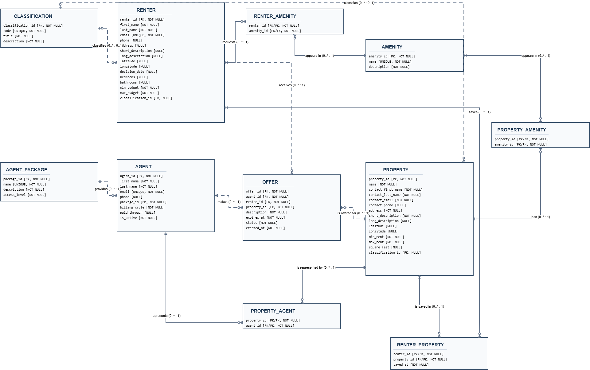

# Assignment 1 - Creating an ER Diagram for MPLSRenters.com
This assignment will meet each of the objectives below:
1. Translate business use cases for data into entity relationships

2. Determine appropriate entity structure for relational databases

3. Apply the correct terminology to a ER Model

4. Design an ER model

## Instructions
For this assignment, your task is to analyze the provided business description and identify the necessary business rules to create an ER diagram. These rules will encompass relationships, constraints, and data requirements.

You are required to compile a README.md file, which will detail each entity along with a brief description of its purpose and the data it collects. Additionally, identify the relationships between entities and note any assumptions or questions you may have for the client based on the business description. You will also decide the answers to your assumptions on behalf of the client.

After completing the README.md file, your next step is to construct an ER Diagram based on the identified relationships from the business description. This diagram should be created using a free web-based tool called 'draw.io.' You'll find the shapes needed for your ER diagram under the 'Entity Relation' tab. Instructions on how to operate draw.io can be found in the assignment resources section below. **DRAW.IO must be used as your ER diagram tool**

## Business Description
MPLSRenters.com is a website that allows prospective apartment renters to create a profile and have
high-end luxury apartments make offers to prospective renters.

1.  A property can have many high-end amenities associated with it. The amenities that are
associated with a property are preset amenities that can be added to a property.  Each amenity will have a name and description. 
 If properties have unique amenities that are not a part of the preset amenities, then those details will go into
the long description for each property. A property will contain information such as first and last name, email, phone, address, short and long description, longitude/latitude of property, and rent range (the lowest and highest amount you can expect to pay).
2. Prospective renters can add as many amenities to their profile as they deem necessary. The amenities will
be the same preset amenities that can be added to a property.  A renter will collect the same information a property would collect, but will also include a renter's decision date, the number of bedrooms and bathrooms, and the lower and max rent value they are willing to spend.  
3. Prospective renters can add as many properties to their profile as they desire. A prospective renter can exist in the system without having a property associated with a profile.
4. A property can have multiple property agents associated with a property. A property does not
have to be associated with a property agent to exist within the database. Property agents can
be activated and deactivated from the system based on whether or not payment for a monthly
package was made on time.
5. Both a profile and a property can receive a classification. There are only three pre-determined
classifications that can be associated with a profile or property. A profile is classified based on
the lower and upper range a prospective renter is looking to have for monthly rent. A
property is classified based on the select amenities, square footage, and lower/upper rent range. Each classification will contain a title, description, and a classification identifier (ex.  A high-luxury, B high - mid-luxury, or C luxury property)
6. A property agent can sign-up for one of three packages. All property agents must have an agent
package. An agent package determines how much access they will be granted to user profile
information.  An Agent package will contain a name, the package description, and an agent option selection (monthly payment package or yearly payment package)
7. Property agents are able to make multiple offers to those who have profiles in the system. A
profile can receive multiple offers from an agent. A profile can decline or entertain an offer.  An offer will contain information such as a description of the offer, the offer expiration date, and the property name for which the offer is being made.

## Submission Guidelines

For this assignment, you will submit 2 items to the repository that has been assigned to you.  The two items that you will need to submit are listed below: 
1. The README.MD file that identifies the various Entities and a brief description of the entity and possible attributes, relationships, and assumptions. 
   1. When identifying relationships be sure to bold and uppercase the entity name, underline the verb and make sure relationships are bi-directional. 
   2. When identifying assumptions, make sure to answer your assumption with either a Yes or No and make sure your response is properly reflected in the ER diagram.  
   3. You can override this README.MD file that contains the instructions or extend this README.MD file by listing your requirements below the Assignment Resources section.

2. The draw.io XML file that contains your ER Diagram.  You will also need to take a snippet of the ER Diagram and add it as an image in your README file.

Once you have completed both of the items above, you will need to submit the link to your repository for assignment 1 prior to the due date and time listed.  Make sure you receive an email confirmation notifying you that the assignment has been submitted.

### Rubric
| Criteria           | Description                             | Points |
| -------------------| --------------------------------------- | ------ |
|**Deliverable 1 - Write-up documented in README.md file**   | Write-up identifies the various entities with brief description (4pts)   Write-up identifies the various relationships that exist between the entities (6pt)   Write-up list assumptions that provides context for cardinality and entity strength (2 pts)   Write-up contains uppercase entity names, underlined verb and relationships are bi-directional (3 pts)  |   15   |
|**Deliverable 2 - Properly structured ER diagram** | All Entities identified in deliverable 1 are visually represented in Workbench ER diagram. (4pts)   Relationship strength is indicated by solid or dotted line (2pt)   Foreign keys and Primary keys are identified and correctly assigned (2 pts)   Each column name indicates null vs not null (2pt)   Image of ER diagram is depicted in README.MD file (2 pt)   Associative entities are identified and properly captures the relationship between the two entities(3 pts)   |   15   |
|           |        |**Total Points:   30**   |

## Assignment Resources
- [Mark-down Syntax Cheat Sheet](https://enterprise.github.com/downloads/en/markdown-cheatsheet.pdf)
- [Make a ReadMe file Web-based Editor](https://www.makeareadme.com/)
- [Draw.io Web-based diagramming tool](https://app.diagrams.net/)
- [Creating Entity Relationship Diagrams using Draw.io](https://www.youtube.com/watch?v=lAtCySGDD48)

ENTITIES

1. RENTER
   - Stores information about people looking for apartments
   - Include: Name, Email, Phone Number, Preferred Rent Range, Number of Bedrooms and Bathrooms,  and Decision Date
2. PROPERTY
   - Stores information about apartments available for rent
   - Includes: Address, Description, Location, and Minimum and Maximum Rent
3. AMENITY
   - Stores information about luxury features available at apartments
   - Examples: Swimming pool, parking garage, fitness center
4. AGENT
   - Stores information about property agents who make apartment offers to renters
   - Includes: Agent Name, Email, Phone Number, Account Status (active/inactive)
5. AGENT_PACKAGE
   - Stores information about the subscription packages available to property agents
   - Includes: Package Name, Description, Payment Option (monthly/yearly)
6. CLASSIFICATION
   - Stores 3 predetermined luxury classifications for properties and renter profiles
   - Includes: Classification Identifier, Title, Description
7. OFFER
   - Stores apartment offers sent by property agents to renters
   - Includes: Offer Description, Expiration Date, Property being Offered, and Offer Status (declined/under consideration/approved)
8. PROPERTY_AMENITY
   - Connects properties to their available amenities 
   - Allows one property to have multiple amenities and one amenity to belong to multiple properties
9. RENTER_AMENITY
   - Connects renters to the amenities they want in an apartment
   - Allows renters to select multiple preferred amenities
10. RENTER_PROPERTY
    - Stores the properties that prospective renters add to their profiles
    - Allows one renter to save multiple properties
    - Renter can also have no saved properties 
11. PROPERTY_AGENT
    - Connects property agents to the properties they represent
    - Allows one property to have multiple agents
    - Property can exist without having an agent assigned to it

RELATIONSHIPS 

1. RENTER & PROPERTY
   - RENTER can save 0 or many PROPERTIES
   - PROPERTY can be saved by 0 or many RENTERS
   - Relationship: Many-to-Many (M), connected thru RENTER_PROPERTY 
2. PROPERTY & AMENITY
   - PROPERTY can have 0 to many AMENTITIES
   - AMENITY can belong to 0 or many PROPERTIES
   - Relationship: Many-to-Many (M), connected thru PROPERTY_AMENITY
3. RENTER & AMENITY
   - RENTER can select 0 or many AMENITIES
   - AMENITY can be selected by 0 or many RENTERS
   - Relationship: Many-to-Many (M), connected thru RENTER_AMENITY
4. AGENT & PROPERTY
   - AGENT can represent 0 to many PROPERTIES
   - PROPERTY can be represented by 0 to many AGENTS
   - Relationship: Many-to-Many (M), connected thru PROPERTY_AGENT
5. AGENT_PACKAGE & AGENT
   - AGENT_PACKAGE can be selected by 0 or many AGENTS
   - AGENT must select exactly one AGENT_PACKAGE
   - Relationship: One-to-Many (1) 
6. CLASSIFICATION & PROPERTY
   - CLASSIFICATION can describe 0 or many PROPERTIES
   - PROPERTY can have 0 or 1 CLASSIFICATION
   - Relationship: One-to-Many (1)
7. CLASSIFICATION & RENTER
   - CLASSIFICATION can be preferred by 0 or many RENTERS
   - RENTER can prefer 0 or 1 CLASSIFICATION
   - Relationship: One-to-Many (1) 
8. AGENT & OFFER
   - AGENT can make 0 or many OFFERS
   - OFFER must be made by exactly 1 AGENT
   - Relationship: One-to-Many (1)
9. RENTER & OFFER
   - RENTER can receive 0 or many OFFERS
   - OFFER must be sent to exactly 1 RENTER
   - Relationship: One-to-Many (1)
10. PROPERTY & OFFER
   - PROPERTY can be included in 0 or many OFFERS
   - OFFER must refer to exactly 1 PROPERTY
   - Relationship: One-to-Many (1)

ASSUMPTIONS

1. Can a renter have 0 saved properties? --> YES
2. Can a property exist without an assigned agent? --> YES
3. Can an agent represent multiple properties? --> YES
4. Can a property have multiple amenities? --> YES
5. Can renters select multiple preferred amenities? --> YES
6. Is it necessary that every offer belong to one renter, one agent, and one property? -->YES
7. Can a renter receive multiple offers? --> YES
8. Can a property exist without being classified a luxury? --> YES
9. Is it necessary that an agent choose a subscription package? --> YES
10. Can an agent make an offer for a property they do not represent? --> NO

ER Diagram

